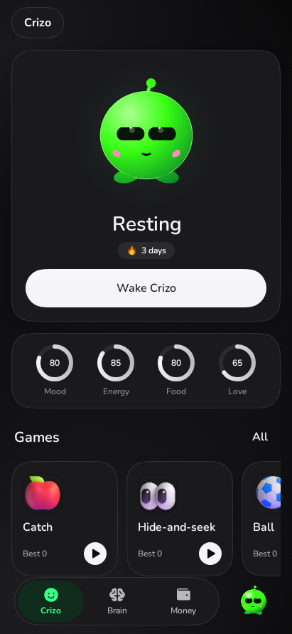
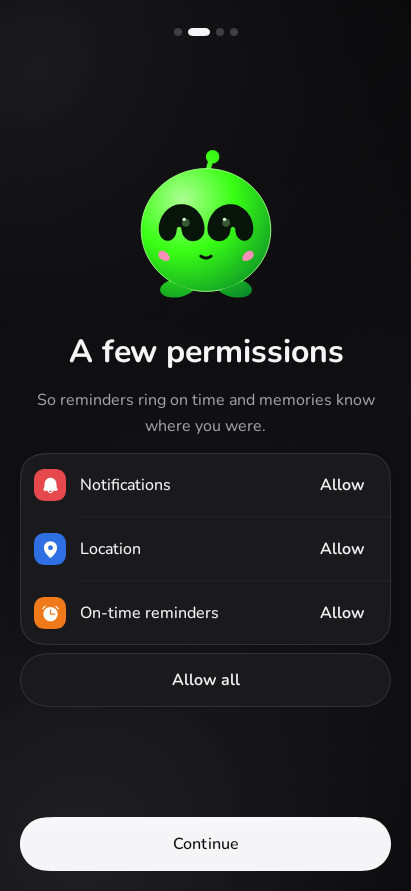

<h1 align="center">Crizo</h1>

<b>A private Android app for your memories, reminders and money.</b>

<a href="https://crizo.criza.dev/">Website</a> ·
<a href="https://crizo.criza.dev/download">Download</a> ·
<a href="https://crizo.criza.dev/guide">Guides</a> ·
<a href="https://crizo.criza.dev/changelog">Changelog</a> ·
<a href="https://crizo.criza.dev/privacy">Privacy</a> ·
<a href="https://crizo.criza.dev/terms">Terms</a>

## Overview

Crizo is a free Android app for Android 13 or newer. It records bank and UPI payments from the notifications of the
apps you choose, turns plain words into reminders and checklists, keeps memories with places and photos, and answers
questions about your own records. All data is stored on the device: there is no account, no advertising and no
tracking.

Crizo is designed and built by [AbrarAli S.](https://github.com/AbraraliS) and published by
[Criza Labs](https://criza.dev), a software studio in Gujarat, India. The app is in early access: every feature is
free, and users who join during early access keep every feature free.

This repository is the public information page for the app. The source code is not published here.

## Features

| Area | What it does |
| --- | --- |
| Payment capture | Reads payment alerts only from the bank, UPI or SMS apps you select, on the device. Clear payments are saved automatically; uncertain ones wait for confirmation. |
| Quick entry | Understands plain input such as “250 lunch at Meghana's” or “1.5k Uber yesterday” and fills in the amount, date, place and category. |
| Reminders and lists | “Remind me to call mom at 6” becomes a reminder; “buy milk, eggs and bread” becomes a checklist. |
| Memories | Notes, photos and voice with place, tags and on-device text recognition. Optional search by meaning with an on-device model. |
| Money overview | Monthly spending, safe to spend per day, budgets with rollover, bills, goals and insights. |
| Assistant | Answers money questions exactly from your records. An optional AI model runs fully offline on the device. |
| Widgets | Money, quick capture and upcoming items on the home screen. |
| Security | Fingerprint lock, optional database encryption and password protected backups to a folder you choose. |
| Updates | Checks crizo.criza.dev once a day and installs a new version only after you confirm. Each download is verified against a SHA-256 checksum. |

## Screenshots

<table>
<tr>
<td align="center" width="25%"> Crizo</td>
<td align="center" width="25%"> Brain</td>
<td align="center" width="25%"> Money</td>
<td align="center" width="25%"> Setup</td>
</tr>
</table>

## Installation

1. Open [crizo.criza.dev/download](https://crizo.criza.dev/download) on an Android phone and download the APK.
2. Allow installs from your browser when Android asks. If Google Play Protect asks, choose *Scan app* or
   *Install anyway*.
3. Open Crizo and allow the permissions you want: notifications, location, on-time reminders and payment alerts.

If Android shows **Restricted setting** when you allow payment alerts, open *App info* for Crizo, tap the menu at the
top right, choose *Allow restricted settings*, and allow access again. The
[installation guide](https://crizo.criza.dev/guide/install-and-update) covers each step.

## Requirements

- Android 13 or newer
- About 40 MB of storage for the app; optional AI models are downloaded separately on Wi-Fi

## Privacy

Crizo processes everything on the device. Criza Labs does not run a server that receives your memories, messages or
financial data. See the [privacy policy](https://crizo.criza.dev/privacy) and [terms of use](https://crizo.criza.dev/terms).

## Frequently asked questions

**Is Crizo free?**
Yes. Every feature is free during early access, and early users keep every feature free.

**Is Crizo available on Google Play?**
Not yet. The official download is [crizo.criza.dev](https://crizo.criza.dev/download), and the app updates itself
from there.

**Does Crizo upload my bank messages?**
No. Payment alerts are read on the device, only from the apps you select.

**How do I report a bug or suggest a feature?**
Write to [crizo@criza.dev](mailto:crizo@criza.dev), or use *Settings › About › Send feedback* in the app.

## Custom apps

Criza Labs builds Android apps, websites and AI automation for businesses. To discuss a custom app, visit
[criza.dev/services/mobile-app-development](https://criza.dev/services/mobile-app-development) or
[contact Criza Labs](https://criza.dev/contact).

## Links

- Website: [crizo.criza.dev](https://crizo.criza.dev)
- On criza.dev: [Crizo for Android](https://criza.dev/products/crizo-app) and the [case study](https://criza.dev/portfolio/crizo-app)
- Machine readable summary: [crizo.criza.dev/llms.txt](https://crizo.criza.dev/llms.txt)
- Also from Criza Labs: [CrizaVoise](https://voise.criza.dev) · [CrizaTools](https://tools.criza.dev) · [Crizo, the site guide](https://github.com/CRIZA-LABS/crizo)

---

© 2026 Criza Labs. Crizo, its name, character and artwork belong to Criza Labs. All rights reserved.
