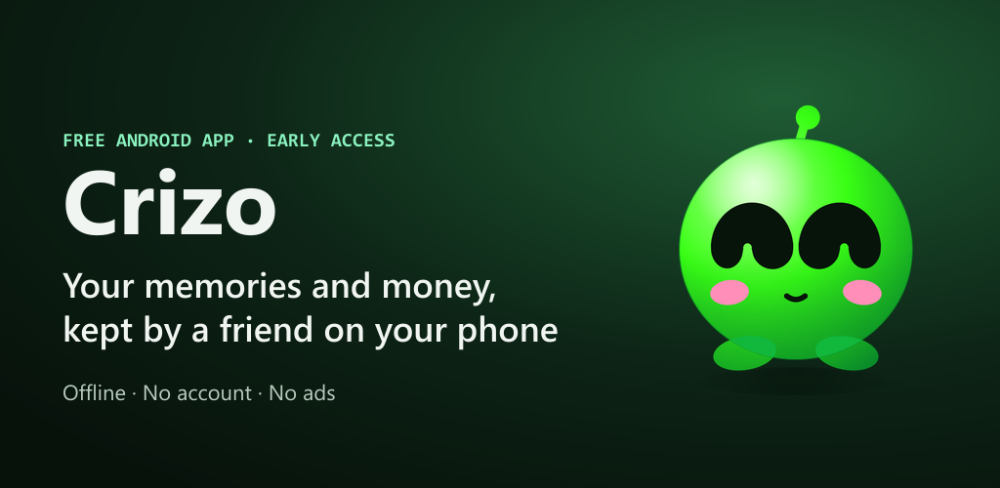
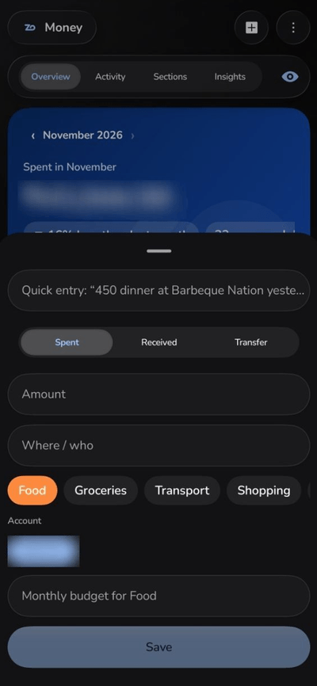
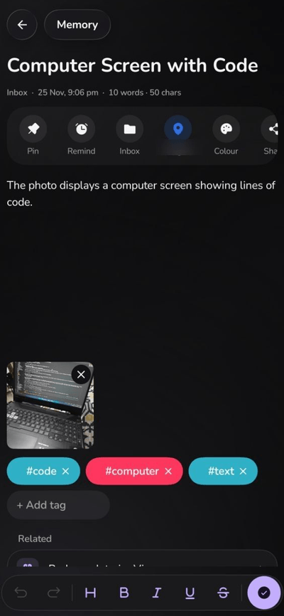
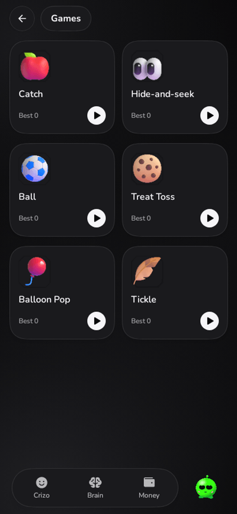
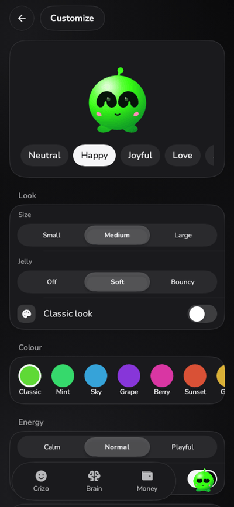

<p align="center"><a href="https://crizo.criza.dev/"></a></p>

<h1 align="center">Crizo for Android</h1>

<p align="center"><b>A free, private Android app for your memories, reminders and money, with a friendly companion.</b></p>

<p align="center">
<a href="https://github.com/CRIZA-LABS/crizo-app/releases/latest"></a>
<a href="https://crizo.criza.dev/download"></a>
<a href="https://crizo.criza.dev/"></a>
<a href="https://crizo.criza.dev/privacy"></a>
</p>

<p align="center">
<a href="https://crizo.criza.dev/">Website</a> ·
<a href="https://github.com/CRIZA-LABS/crizo-app/releases/latest">Download APK</a> ·
<a href="https://crizo.criza.dev/guide">Guides</a> ·
<a href="CHANGELOG.md">Changelog</a> ·
<a href="https://crizo.criza.dev/privacy">Privacy</a> ·
<a href="https://crizo.criza.dev/terms">Terms</a>
</p>

## What is Crizo?

**Crizo is a free Android app that keeps your memories, reminders and money in one private place on your phone.** It
saves bank and UPI payments automatically from the notifications of apps you choose, turns plain words like “remind me
to call mom at 6” into reminders, keeps notes, photos and voice notes with the place they were made, and answers
questions about your own records. A small companion, also called Crizo, keeps you company and plays games with you.
Everything is stored on the phone: no account, no ads, no tracking.

Crizo is designed and built by [AbrarAli S.](https://github.com/AbraraliS) and published by
[Criza Labs](https://criza.dev), a software studio in Gujarat, India.

| | |
| --- | --- |
| **Latest version** | 0.10.10 (version code 29), 27 November 2026 |
| **Platform** | Android 13 or newer |
| **Price** | Free, early access. No ads, no in-app purchases |
| **Size** | About 36 MB; optional on-device AI models download separately on Wi-Fi |
| **Package name** | `dev.criza.crizo` |
| **Account** | None needed |
| **Data** | Stored only on the phone |
| **Official downloads** | [crizo.criza.dev/download](https://crizo.criza.dev/download) and [GitHub Releases](https://github.com/CRIZA-LABS/crizo-app/releases) |
| **Source code** | Not published (this repository holds the app's public page and releases) |

## Features

| Area | What it does |
| --- | --- |
| **Payment capture** | Reads payment alerts only from the bank, UPI or SMS apps you select, on the device. Clear payments are saved automatically; unclear ones wait for one tap. |
| **Quick entry** | Understands “450 dinner yesterday” or “1.5k Uber” and fills in amount, date, place and category. |
| **Money** | Monthly spending, budgets with rollover, bills, goals, people (splits and IOUs), accounts, categories, smart rules and insights. |
| **Reminders and lists** | “Remind me to pay rent every month at 10am” becomes a repeating reminder; “buy milk, eggs and bread” becomes a checklist. |
| **Memories** | Notes, checklists, photos and voice notes with place and tags. Text in photos is read on the device. Search forgives typos; optional search by meaning. |
| **Voice notes** | Record with pause and resume; the words, a title and tags are written down on the phone. |
| **Places and memory map** | Every memory keeps its place; see them on a map, or see how memories connect in a graph. |
| **Ask Crizo** | Money questions are answered exactly from your records. An optional AI model runs fully offline on the device. |
| **Undo, Archive and Bin** | Undo after every delete or archive. Deleted items stay 30 days in the Bin. |
| **Companion** | Six characters, 27 accessories, daily care, six games. Can float over the phone or rest in the app. |
| **Security** | Fingerprint lock, optional database encryption, password protected backups to a folder you choose. |
| **Widgets** | Money, quick capture and upcoming items on the home screen. |

## Screenshots

<table>
<tr>
<td align="center" width="25%"><br><sub>Crizo</sub></td>
<td align="center" width="25%"><br><sub>Money</sub></td>
<td align="center" width="25%"><br><sub>Quick add</sub></td>
<td align="center" width="25%"><br><sub>Brain</sub></td>
</tr>
<tr>
<td align="center"><br><sub>Memory</sub></td>
<td align="center"><br><sub>Games</sub></td>
<td align="center"><br><sub>Customize</sub></td>
<td></td>
</tr>
</table>

## Characters

<p align="center"></p>

| Character | Personality |
| --- | --- |
| Crizo | Playful and bouncy, loves to climb and dance |
| Kiko | Calm and curious, floats, thinks and sits with you |
| Momo | Sleepy and cuddly, naps in sunny spots and sits close |
| Bolt | Eager little robot, always busy and on the move |
| Mochi | Bouncy jelly, hops everywhere and loves to dance |
| Wisp | Quiet and dreamy, drifts about and naps on the ceiling |

Each character can wear 27 accessories, from a party hat to a Viking helmet. See the
[characters and outfits guide](https://crizo.criza.dev/guide/characters-and-outfits).

## Download and install

**Option 1: website.** Open [crizo.criza.dev/download](https://crizo.criza.dev/download) on your phone.

**Option 2: GitHub Releases.** Download `crizo-<version>.apk` from the
[latest release](https://github.com/CRIZA-LABS/crizo-app/releases/latest). Older versions are kept in
[all releases](https://github.com/CRIZA-LABS/crizo-app/releases).

**Option 3: automatic updates with Obtainium.** In [Obtainium](https://github.com/ImranR98/Obtainium), add the app
URL `https://github.com/CRIZA-LABS/crizo-app`. Crizo also checks crizo.criza.dev once a day and offers new versions
itself, so you do not need Obtainium to stay up to date.

Then:

1. Allow installs from your browser or file manager when Android asks. If Google Play Protect asks, choose
   *Scan app* or *Install anyway*.
2. Open Crizo and allow only the permissions you want.
3. If Android shows **Restricted setting** when you allow payment alerts, open *App info* for Crizo, tap the menu at
   the top right, choose *Allow restricted settings*, and allow access again.

The [installation guide](https://crizo.criza.dev/guide/install-and-update) covers each step.

### Verify a download

Every release lists the APK's SHA-256 checksum, and all versions are signed with the same key.

| | |
| --- | --- |
| Signing certificate SHA-1 | `0E:73:A3:80:3B:7A:B3:AE:2C:40:4A:31:5C:DF:C2:16:C2:08:D4:D7` |

```sh
sha256sum crizo-0.10.10.apk
```

Compare the result with the checksum in the release notes. Android refuses an update signed with a different key.

## Guides

- [Getting started](https://crizo.criza.dev/guide/getting-started)
- [Install, permissions and updates](https://crizo.criza.dev/guide/install-and-update)
- [How payment capture works](https://crizo.criza.dev/guide/payment-capture)
- [Ask Crizo about your own life](https://crizo.criza.dev/guide/ask-crizo)
- [Characters, outfits and games](https://crizo.criza.dev/guide/characters-and-outfits)
- [Undo, Archive and the Bin](https://crizo.criza.dev/guide/undo-archive-bin)
- [Voice notes, places and the memory map](https://crizo.criza.dev/guide/voice-notes-and-places)
- [Widgets and shortcuts](https://crizo.criza.dev/guide/widgets-and-shortcuts)

## Frequently asked questions

**What is Crizo?**
A free Android app by Criza Labs for memories, reminders and money, with a companion. It saves bank and UPI payments
automatically and keeps all data on the phone.

**Is Crizo free?**
Yes. Crizo is free in early access, with no ads and no in-app purchases. Early users keep every feature free.

**Is Crizo safe to install from GitHub or the website?**
Yes, when you download from crizo.criza.dev or this repository's releases. Each APK is signed with the same key and
listed with its SHA-256 checksum, so you can check the file is the original.

**Is Crizo on Google Play?**
Not yet. Download it from [crizo.criza.dev](https://crizo.criza.dev/download) or
[GitHub Releases](https://github.com/CRIZA-LABS/crizo-app/releases/latest). The app updates itself.

**Does Crizo upload my bank messages or payments?**
No. Payment alerts are read on the phone, only from the apps you select. Criza Labs has no server that receives your
data.

**Does Crizo work offline?**
Yes. It uses the internet only for downloads you choose (the optional AI model, map squares) and the daily update
check.

**Which phones does Crizo support?**
Android phones running Android 13 or newer.

**Can I get an older version?**
Yes. Every published version is in [Releases](https://github.com/CRIZA-LABS/crizo-app/releases). To go back, uninstall
first: Android does not install an older version over a newer one.

**How do I report a bug or suggest a feature?**
Write to [crizo@criza.dev](mailto:crizo@criza.dev), or use *Settings › About › Send feedback* in the app.

## Custom apps

Criza Labs builds Android apps, websites and AI automation for businesses. See
[criza.dev/services/mobile-app-development](https://criza.dev/services/mobile-app-development) or
[contact Criza Labs](https://criza.dev/contact).

## Links

- Website: [crizo.criza.dev](https://crizo.criza.dev)
- On criza.dev: [Crizo for Android](https://criza.dev/products/crizo-app) and the [case study](https://criza.dev/portfolio/crizo-app)
- Machine readable summary: [crizo.criza.dev/llms.txt](https://crizo.criza.dev/llms.txt)
- Also from Criza Labs: [CrizaVoise](https://voise.criza.dev) · [CrizaTools](https://tools.criza.dev) · [Crizo, the site guide](https://github.com/CRIZA-LABS/crizo)

---

<sub>© 2026 Criza Labs. All rights reserved. Crizo is proprietary software, free to install and use, provided "as is" without any warranty or liability. See [LICENSE](LICENSE) and the [Terms of Use](https://crizo.criza.dev/terms).</sub>
