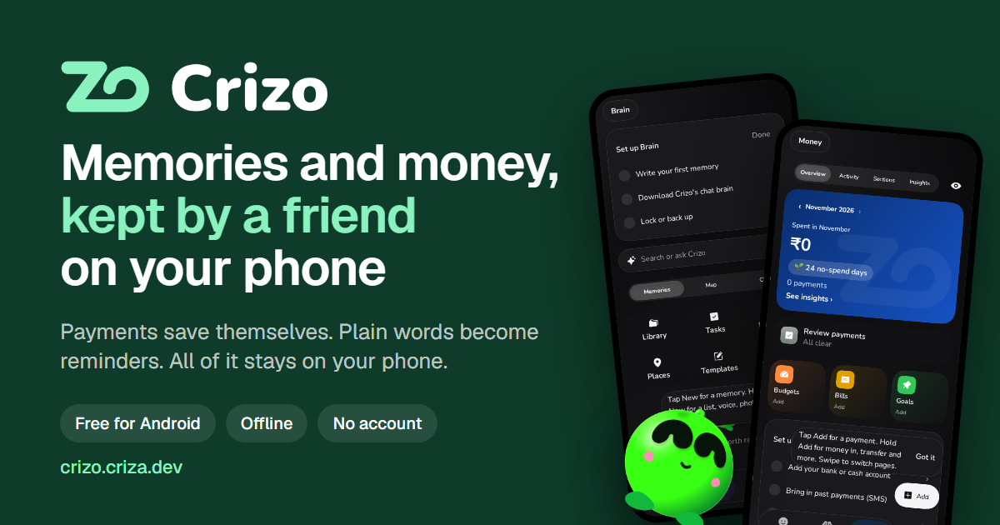
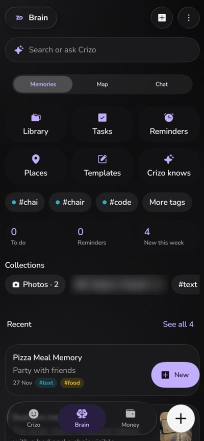
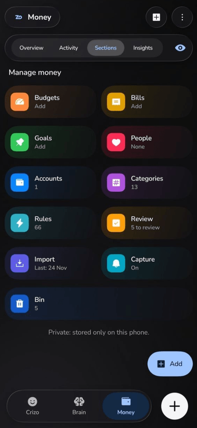

<h1 align="center">Crizo: memories and money, kept by a friend on your phone</h1>

A free Android app that saves your bank and UPI payments by itself, turns plain words into reminders, 
and answers questions about your own life. Offline, private, no account, no ads.

<b><a href="https://crizo.criza.dev/download">Download</a></b> ·
<a href="https://crizo.criza.dev/guide/getting-started">Getting started</a> ·
<a href="https://crizo.criza.dev/guide/install-and-update">Install and permissions</a> ·
<a href="https://crizo.criza.dev/guide/payment-capture">Payment capture</a> ·
<a href="https://crizo.criza.dev/privacy">Privacy</a> ·
<a href="https://crizo.criza.dev/terms">Terms</a>

**Crizo** is a free Android app for Android 13 or newer, designed and built by
[AbrarAli S.](https://github.com/AbraraliS) and published under [Criza Labs](https://criza.dev), a software studio in
Gujarat, India. It keeps your memories, reminders and money in one private place on your phone, with a friendly green
companion, also called Crizo, who helps. Crizo is in **early access**: every feature is free, and early users will not
have to pay later.

> This repository is the public page for the Crizo app. It explains what the app does and links to the official
> website, where you can download it. The app's source code is not published here.

## What Crizo does

| | |
| --- | --- |
| **💸 Payments save themselves** | When your bank, UPI or card app shows a payment alert, Crizo records it with the right category. Clear payments are saved at once; unclear ones wait for one tap. |
| **⏰ Plain words become reminders** | Type “remind me to call mom at 6” or “buy milk, eggs and bread” and you get a reminder or a checklist. |
| **🧠 Memories that know the place** | Save notes, photos and voice. Crizo adds the place, a title and tags, and reads the text in your photos on the phone. |
| **💬 Ask about your own life** | “How much did I spend on food this month?” is answered exactly from your records. An optional offline AI model answers more. |
| **📊 Budgets, bills and safe to spend** | See what you spent, what is safe to spend per day, bills due, budgets, goals and insights. |
| **🏠 Widgets** | Money, quick capture, up next and Crizo, right on your home screen. |
| **🔒 Private by design** | No account, no ads, no tracking. Fingerprint lock, optional encryption and password protected backups to a folder you choose. |
| **🟢 A companion with moods** | Crizo has moods, colours and mini games, and can float over your screen if you want him to. |

## Screens

<table>
<tr>
<td align="center" width="25%"> <b>Crizo</b>: your companion</td>
<td align="center" width="25%"> <b>Brain</b>: memories, lists, reminders</td>
<td align="center" width="25%"> <b>Money</b>: spending, budgets, bills</td>
<td align="center" width="25%"> <b>Setup</b>: allow only what you want</td>
</tr>
</table>

## Get started in a minute

1. **Download** the APK from [crizo.criza.dev/download](https://crizo.criza.dev/download) on your Android phone.
2. **Install** it. Android asks once to allow installs from your browser. If Play Protect asks, tap *Scan app* or
   *Install anyway*.
3. **Allow** the permissions you want on the welcome screen: notifications, location, on time reminders and payment
   alerts.
4. **Use it.** Tap *New* in Brain for a memory, *Add* in Money for cash, and let bank and UPI payments save themselves.

If Android says **“Restricted setting”** when you allow payment alerts: open *App info* for Crizo, tap *⋮*, choose
*Allow restricted settings*, and allow access again.
[Full install and permissions guide](https://crizo.criza.dev/guide/install-and-update).

Updates come to you: Crizo checks [crizo.criza.dev](https://crizo.criza.dev) once a day and installs a new version
only after you confirm on Android’s own screen.

## Frequently asked questions

**What is Crizo?**
Crizo is a free Android app that keeps your memories, reminders and money in one private place on your phone, with a
friendly companion character. It records bank and UPI payments from notifications, turns plain words into reminders
and answers questions about your own records.

**Is Crizo free?**
Yes. Crizo is in early access, so every feature is free, and people who start using it now will not have to pay later.
You can support it with a coffee if you like.

**Where is my data stored?**
Only on your phone. There is no account and no server that receives your memories or money. You can lock and encrypt
them and make backups to a folder you pick.

**How does Crizo read my payments?**
If you allow notification access, Crizo reads payment alerts only from the apps you pick, such as your bank, UPI or SMS
app, on the phone. Other notifications are ignored.

**Which phones does Crizo work on?**
Android phones running Android 13 or newer.

**Is Crizo on the Play Store?**
Not yet. Download it from [crizo.criza.dev](https://crizo.criza.dev/download), the only official source.

**Who makes Crizo?**
Crizo is designed and built by [AbrarAli S.](https://github.com/AbraraliS) and published under
[Criza Labs](https://criza.dev) in Gujarat, India. Questions: [crizo@criza.dev](mailto:crizo@criza.dev).

## Links

- Website: [crizo.criza.dev](https://crizo.criza.dev)
- Download: [crizo.criza.dev/download](https://crizo.criza.dev/download)
- Guides: [crizo.criza.dev/guide](https://crizo.criza.dev/guide)
- For AI assistants: [crizo.criza.dev/llms.txt](https://crizo.criza.dev/llms.txt)
- Privacy policy: [crizo.criza.dev/privacy](https://crizo.criza.dev/privacy) · Terms: [crizo.criza.dev/terms](https://crizo.criza.dev/terms)
- Also from Criza Labs: [Criza Labs](https://criza.dev) · [CrizaVoise](https://voise.criza.dev) · [CrizaTools](https://tools.criza.dev) · [Crizo, the site guide on criza.dev](https://github.com/CRIZA-LABS/crizo)

© 2026 Crizo · Made by <a href="https://criza.dev">Criza Labs</a> in Gujarat, India. Crizo, its name, character and artwork belong to Criza Labs. All rights reserved.

